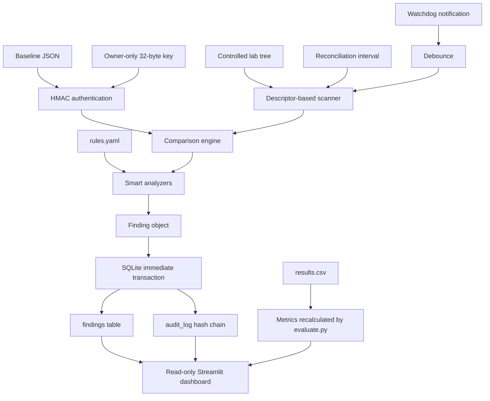

# Architecture and data flow

## Component view

| Component | Responsibility | Main files |
|---|---|---|
| Sandbox | Synthetic Linux-like configuration and log fixtures | `lab/`, `make_lab.py` |
| Scanner | Safely enumerate regular files, hash content, capture metadata and small text snapshots | `forace/scanner.py` |
| Baseline | Validate/store the file map and root identity | `forace/baseline.py` |
| Trust layer | Generate owner-only HMAC key, sign exact baseline bytes, authenticate before parsing | `forace/auth.py` |
| Detection | Compare file sets/content/metadata and run supported semantic analyzers | `forace/detection.py`, `analyzers.py`, `rules.py`, `rules.yaml` |
| Monitor | Watchdog notifications, event debounce, scans, periodic reconciliation, finding persistence | `forace/monitor.py`, `cli.py` |
| Storage | SQLite finding rows and sequential hash-chained audit entries | `forace/store.py` |
| Evaluation | Fresh isolated scenario copies, smart/hash-only comparisons, metrics and CSV/report | `attacks/`, `evaluate.py` |
| Demo | End-to-end R01 demonstration with isolated tamper simulation | `demo.py` |
| Dashboard | Read-only status, finding, audit-event, and evaluation views | `dashboard.py`, `forace/dashboard_data.py` |

## Data flow



### Initialization

1. `init` resolves and validates the controlled `lab/` directory.
2. `create_baseline` scans every regular file. Any scan error prevents a
   baseline from being created, so an incomplete walk cannot silently be
   trusted.
3. `auth.py` signs the exact JSON bytes with HMAC-SHA256. The key is 32 random
   bytes, created exclusively with mode `0600`.
4. The SQLite schema is initialized, the existing audit chain is verified, and
   a `baseline_initialized` audit event is appended.

When either baseline or signature already exists, replacing trust material
requires `--approve-update`. Existing invalid audit data is checked before the
CLI modifies baseline trust files.

### Monitoring and comparison

The monitor authenticates the baseline and checks that its recorded root
matches the selected lab. Watchdog events are debounced; the handler then
rescans rather than opening the event path directly. A second worker performs
full scans on a configurable interval. Both paths use `compare_scans`.

The scanner uses directory file descriptors and `O_NOFOLLOW` for root, child
directories, and regular files. Metadata and content are read from the same
opened inode. If the inode changes while it is being read, the entry becomes a
scan error. Symbolic links are not traversed. A scan error for a previously
known path suppresses an inferred deletion for that path and descendants.

Smart mode evaluates supported configuration semantics and selected metadata
changes. Hash-only mode reports file additions, deletions, and content changes.
Both modes use SHA-256 content digests; hash-only simply omits semantic rule
analysis and metadata alerts.

### Finding storage and audit

For each finding, the monitor computes a fingerprint from the finding,
current-file digest, and baseline digest. In one `BEGIN IMMEDIATE` transaction
it verifies the existing audit chain, checks for a duplicate fingerprint,
inserts the finding, and appends its chained audit row. Invalid chains refuse
new finding and audit appends. Finding de-duplication prevents repeated
Watchdog notifications and reconciliation passes from adding the same finding
for the same state.

### Evaluation and dashboard

`evaluate.py` creates a separate private temporary workspace per scenario. It
copies the source lab, marks the copy, creates a new baseline and HMAC key,
authenticates them, applies one safe simulator, and compares both modes from
the same scan. Temporary scenario copies are removed after each run.

The dashboard uses SQLite read-only URI connections, verifies rather than
repairs the baseline and audit chain, and recalculates metrics from
`results.csv`. An empty audit chain is shown as empty, not verified. A missing
or invalid data source never produces invented findings.

## Workspace file layout

```text
FORACE/
├── attacks/                  # Isolated synthetic scenarios
├── data/                     # Local baseline, key, signature, SQLite, heartbeat
├── docs/                     # Architecture, security, evaluation, demo and viva
├── forace/                   # Scanner, baseline, detection, monitor and storage
├── integritywatch/           # Backward-compatible imports and module entry point
├── lab/                      # Synthetic Linux-like test tree
├── tests/                    # Phase 1–6 regression and integration tests
├── dashboard.py              # Streamlit read-only dashboard
├── demo.py                   # Repeatable isolated demonstration
├── evaluate.py               # Scenario runner and metric/report generator
├── make_lab.py               # Synthetic sandbox generator
├── results.csv               # Measured Phase 4 scenario output
└── rules.yaml                # R01–R12 rule metadata
```
